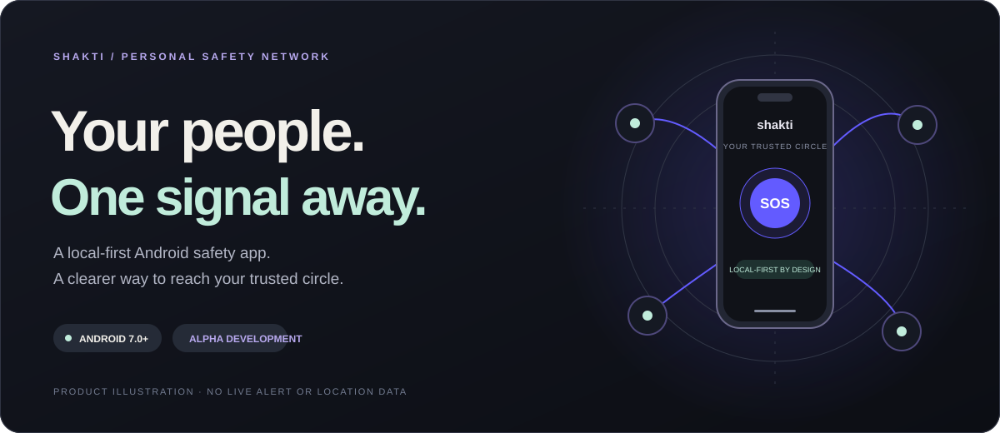
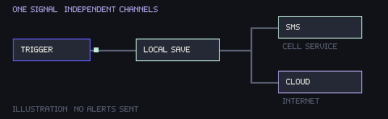
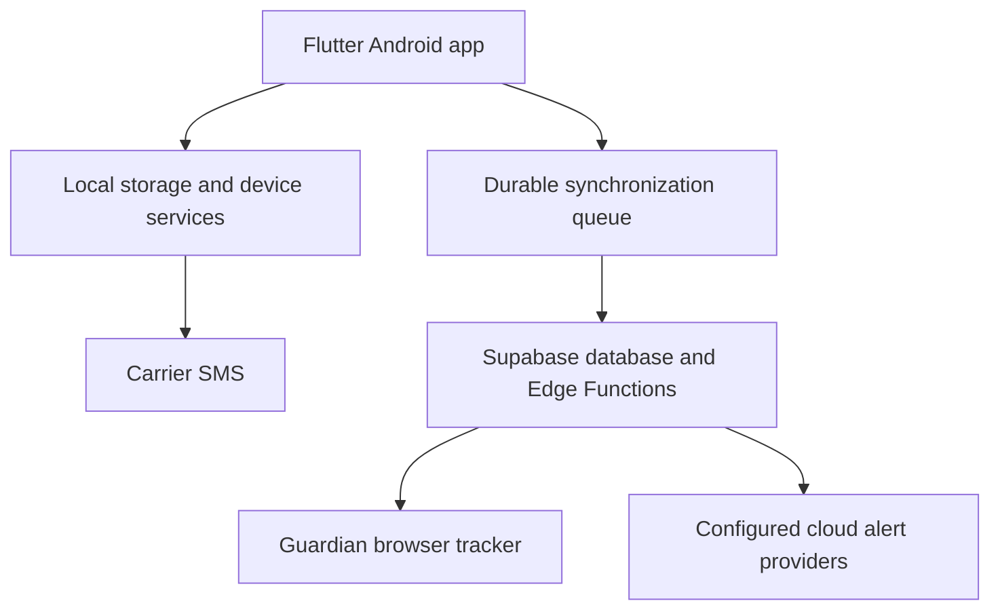

<p align="center">
  
</p>

<h1 align="center">Shakti</h1>

<p align="center">
  <strong>Your people. One signal away.</strong><br>
  Personal safety, built around the people you trust.
</p>

<p align="center">
  <a href="https://github.com/lekhanpro/shakti/actions/workflows/ci.yml"></a>
  
  
  
</p>

<p align="center">
  <a href="#why-shakti">Why Shakti</a> ·
  <a href="#the-toolkit">Features</a> ·
  <a href="#get-started">Get started</a> ·
  <a href="#how-it-fits-together">Architecture</a> ·
  <a href="#verification-and-releases">Verification</a> ·
  <a href="docs/development-guide.md">Developer guide</a>
</p>

<p align="center">
  
</p>

**Shakti is an Android personal-safety app with local SOS, trusted-contact SMS, encrypted audio evidence, and a browser-based guardian tracker.** The app saves emergency state on the phone and attempts each alert channel independently, so an internet request does not hold up carrier SMS.

> **Development status:** source implementation is available; this branch is being verified. Physical-device reliability, hosted integrations, finalized branding, signed release readiness, and a published Play alpha require their own evidence. The badge above reports **main**, not this PR's checks. [Review the implementation audit](docs/implementation-audit.md).

## Why Shakti

A person under stress may have only a moment to act. A guardian may have no app installed. A phone may have cellular coverage while mobile data is unavailable.

Shakti brings these constraints into one workflow: raise an SOS, keep the local incident, attempt the available channels, and let trusted people open a tracker link when incident data has synced.

| Start with an action | Keep the channels independent | Give your circle context |
| --- | --- | --- |
| On-screen SOS, configured hardware/sensor triggers, escort expiry, or a discreet duress PIN | Local save, carrier SMS, optional evidence, and cloud attempts have separate outcomes | Token-based browser tracking shows the available trail, battery, status, and update time |

## The toolkit

| Before a walk | During an incident | After the moment |
| --- | --- | --- |
| Four-step onboarding and explained permissions | Five-second default countdown with cancellation | PIN-confirmed resolution |
| Trusted contacts and safe places | SMS independent of internet requests | Incident history and encrypted evidence vault |
| PIN, biometrics, and lock controls | Alternate triggers, silent duress, siren, and strobe | Audio playback and export |
| Walk With Me timer and check-in | Local breadcrumbs and queued synchronization | AI assistance and a reviewed FIR draft |
| Nearby useful places and scored routes | Guardian tracking in a browser | Offline FIR template and PDF/share workflow |

**Requirements stay explicit.** Android power/volume behavior varies by device. AI and fresh map/routing requests need connectivity. Route scores do not guarantee safety; an FIR draft is not an official submission.

### What an SOS does

1. A supported trigger starts the ordinary countdown; duress bypasses it silently.
2. Shakti attempts a local incident save.
3. SMS, configured cloud alerts, and optional audio/siren run as independent channels.
4. Local breadcrumbs queue for upload; the guardian tracker refreshes available data.
5. A verified resolution updates the incident and attempts appropriate follow-up notifications.

<p align="center">
  
</p>

<p align="center"><sub>Explanatory motion graphic. No real alert, recipient, location, or delivery result.</sub></p>

### Without mobile data

| Available locally or through cellular service | Needs internet when requested |
| --- | --- |
| Contacts, settings, countdown, incident storage, PIN/decoy UI | Cloud alert dispatch and remote tracker updates |
| Carrier SMS, with SIM, permission, cellular service and a suitable plan | AI-generated responses |
| Audio recording/encryption, siren/strobe with permissions and hardware | Fresh map tiles, routing, geocoding and nearby-place requests |
| GPS/local breadcrumbs, subject to permission and a usable fix | Queued incident/breadcrumb upload |
| Previously cached places and the offline FIR template | Guardian access to the hosted tracker |

**SMS handoff is not delivery confirmation.** A backend acknowledgment does not establish that a guardian has seen an alert.

## Get started

**Toolchain:** Flutter **3.47.5** with its compatible Dart SDK; Android SDK/JDK **21**; Node.js **22**; Deno **2** for Edge Functions. Cloud development also needs Supabase configuration.

```bash
git clone https://github.com/lekhanpro/shakti.git
cd shakti/app
flutter pub get
dart run build_runner build --delete-conflicting-outputs
flutter run
```

This launches local development without certifying hardware channels or configuring hosted services. Set up your PIN and consenting test contacts, then check permissions before testing.

<details>
<summary><strong>Run the website</strong></summary>

From the repository root:

```bash
cd web
npm ci
cp .env.example .env.local
npm run dev
```

Open `http://localhost:3000`; `/track/demo` uses synthetic data. On PowerShell use `Copy-Item .env.example .env.local`.

</details>

<details>
<summary><strong>Connect the Android app to your development backend</strong></summary>

From `app/`:

```bash
flutter run --dart-define=SUPABASE_URL=https://YOUR_PROJECT_REF.supabase.co --dart-define=SUPABASE_ANON_KEY=YOUR_PUBLIC_ANON_KEY --dart-define=TRACK_BASE_URL=https://YOUR_TRACKER_HOST
```

Use the same Supabase project for the phone, functions and website. Enable the required Auth configuration, apply migrations, and configure server-side provider secrets. Never put service-role, AI, Telegram or signing credentials in client code.

See the [complete development guide](docs/development-guide.md) for setup, configuration, commands, troubleshooting and Windows toolchain notes.

</details>

## How it fits together



| Layer | Stack | Responsibility |
| --- | --- | --- |
| Android app | Flutter, Riverpod, Drift, Kotlin | Local state, SOS orchestration, triggers, contacts, maps and evidence |
| Backend | Supabase Postgres/Auth, RLS, Deno functions | Owned incident data, invitations, token-scoped reads, AI and cloud dispatch |
| Website | Next.js, React, TypeScript, Three.js, Leaflet | Product story, interactive demonstrations and guardian tracking |
| Delivery | GitHub Actions | Analysis, tests, coverage, native checks, builds and gated packages |

The tracker uses a token-scoped RPC. Empty Realtime invalidation signals request a fresh read, with ten-second polling as fallback. Anonymous clients receive no direct incident-table grants.

## Verification and releases

| Check | What it establishes |
| --- | --- |
| Flutter analysis, tests and coverage gate | Automated app behavior; domain/data line coverage target ≥80% |
| Android debug APK and Kotlin detector tests | Android compilation and native detector unit behavior |
| Deno checks/tests | Function validation and handler behavior with test dependencies |
| Fresh SQL migrations and RLS assertions | Disposable-database schema and access-control behavior |
| Web typecheck, tests, build and Chromium checks | Website compilation, selected interactions, mobile/reduced-motion and WebGL fallback |
| Signed release APK and AAB | Packaging with the configured upload key after shared verification |

**First testing package:** the workflow publishes a private, debug-signed Android prerelease only after all automated gates pass. It is built without hosted-backend configuration. Its availability is determined by the actual [Releases page](https://github.com/lekhanpro/shakti/releases), not by this README.

Production signing, configured cloud integration, Play distribution, real SMS receipt, locked-screen triggers and battery measurements remain separate gates. See the [Android testing/release guide](docs/android-testing-release.md) and [hardware QA checklist](docs/qa-checklist.md).

## Review checkpoints

The combined PR preserves four review milestones as separate commits:

| Checkpoint | Focus |
| --- | --- |
| Week 1 | Requirements, documentation and implementation audit |
| Week 2 | SOS and escort reliability with regressions |
| Week 3 | Website experience and guardian refresh |
| Week 4 | Verification, Android builds and release automation |

[Exact commit SHAs and restore instructions](docs/review-milestones.md) let you inspect an earlier week without resetting the latest project. These are review checkpoints prepared now; actual weekly reviews and field results keep their real dates.

## Find your way around

| Path | Contents |
| --- | --- |
| [`app/`](app/) | Flutter app, Android integration and tests |
| [`supabase/`](supabase/) | Migrations, functions and SQL assertions |
| [`web/`](web/) | Product website and guardian tracker |
| [`docs/`](docs/) | Product specifications, audit, QA, releases and academic reviews |
| [`scripts/`](scripts/) | Review snapshot tooling |
| [`.github/workflows/`](.github/workflows/) | Executable checks and delivery workflows |

**Read next:** [Development guide](docs/development-guide.md) · [Design specification](docs/specs/2026-09-29-shakti-design.md) · [Implementation plan](docs/plans/2026-09-29-shakti-implementation-plan.md) · [Feature audit](docs/implementation-audit.md) · [Community-review kit](docs/community-review/README.md) · [Brand assets](docs/assets/README.md)

## Contribute with care

Read [the project conventions](CLAUDE.md), preserve provider and domain boundaries, keep SMS independent of network requests, and include relevant automated results and device limitations in changes. Use shared design tokens, semantics, accessible controls and reduced-motion support.

Keep signing keys and identifiable test data outside the repository. Send controlled test alerts only to informed contacts.

---

<p align="center">
  Built by <strong>Lekhan · Manas · Vikat · Hemanth</strong><br>
  Don Bosco Institute of Technology, Bengaluru · VTU 1BCP308<br>
  <sub>No repository-wide license is currently supplied. Third-party components retain their applicable licenses.</sub>
</p>
