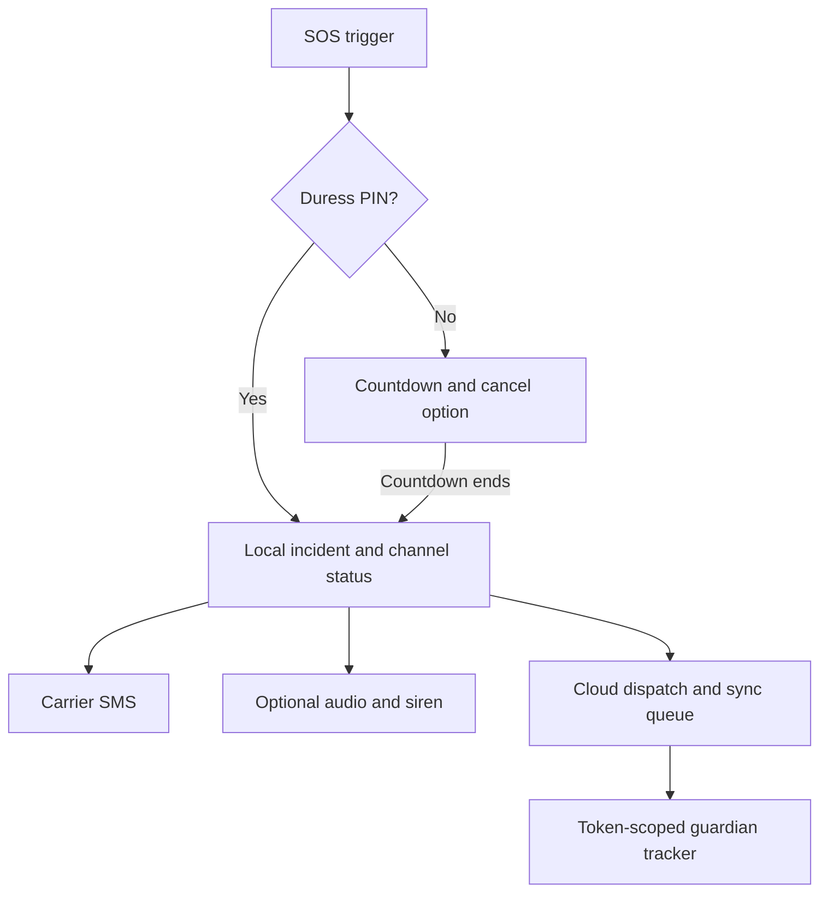

# Shakti development guide

Complete setup, configuration, validation and operational reference. Start with the [project overview](../README.md).

[](https://github.com/lekhanpro/shakti/actions/workflows/ci.yml)


**Shakti is an Android personal safety app with a local-first SOS workflow, trusted-contact SMS, encrypted audio evidence, and a browser-based guardian tracker.** It combines a Flutter app, native Android triggers, a Supabase backend, and a Next.js website in one repository.

The goal is straightforward: make it easier to raise an alert, tell trusted people what is happening, and share useful information when connectivity is unreliable. Guardians can receive SMS and open a tracking link without installing Shakti.

> **Project status:** implementation and automated CI are available. Physical-device validation, completed community-review evidence, and a published Play alpha must be recorded separately. This repository does not establish guaranteed message delivery, emergency-service integration, or a live production rollout.

**Explore:** [Features](#features) · [SOS workflow](#how-an-sos-works) · [Architecture](#architecture) · [Setup](#getting-started) · [Configuration](#configuration-reference) · [Testing](#testing-and-validation) · [Release](#building-and-releasing) · [Project reviews](#academic-project-and-community-reviews) · [Documentation](#documentation)

## Why Shakti exists

A personal safety workflow should remain useful when mobile data drops, a user cannot comfortably navigate a screen, or a guardian does not have the same app installed.

Shakti keeps emergency state on the phone first and treats each alert channel independently. SMS does not wait for an internet request. Cloud synchronization can retry later. The interface exposes channel outcomes so a failed alert is visible instead of being hidden behind one overall success message.

## Features

| Area | What is implemented | Conditions and boundaries |
| --- | --- | --- |
| SOS and cancellation | On-screen SOS, a configurable countdown, cancellation, active incident status, and PIN-confirmed resolution | The ordinary flow provides a cancellation window; a duress trigger bypasses it |
| Alternative triggers | Native triple-power detection, opt-in volume-key accessibility support, shake detection, voice phrase matching, and escort timer expiry | Power detection uses screen-toggle events; device behavior, permissions, background limits, and false triggers need hardware testing |
| Trusted contacts | Local contact management and carrier SMS with incident information and a tracker link | Needs a usable SIM, cellular service, SMS capability, and permission; Android accepting a send request is not proof of delivery |
| Guardian tracker | Token-based browser view with incident status, location history, battery information, and last-update information | Needs the configured backend, uploaded incident data, and internet on the guardian's device |
| Location and sync | Local breadcrumb storage during an incident and a durable retry queue for cloud uploads | The app samples on a 10-second interval; actual freshness depends on GPS, Android scheduling, and connectivity |
| Walk With Me | An escort timer, check-in flow, and an SOS when the timer expires | Screen-off and background behavior require device validation |
| Discreet assistance | A decoy PIN/notes interface, silent duress flow, fake-call screen, and siren/strobe controls | Sound, torch, vibration, and microphone capabilities vary by device and permission |
| Evidence vault | Audio recording with encrypted local storage, playback, and export workflows | Microphone permission and available storage are required; exported evidence needs separate care |
| Safety map | Nearby places from Overpass, geocoding through Nominatim, routing through OSRM, and cached place data | Fresh map tiles, searches, and route requests need internet; route scores do not establish that a route is safe |
| AI assistance and FIR drafts | Backend-proxied AI chat, FIR drafting, PDF/share support, and an offline FIR template | AI needs a configured backend/provider and internet; generated text needs user review and is not an official FIR submission |
| App access controls | PIN hashing, biometric integration, app locking, secure-storage integration, and screenshot/backup restrictions | Automated tests do not replace device and security validation |

### What works without internet?

“Offline-first” describes how local emergency state and available device channels are handled. It does not mean every feature is available without a network.

| Capability | Internet needed? | Other requirements |
| --- | --- | --- |
| Local contacts, settings, incident history, and queue | No | Working device storage |
| SOS countdown, PIN/decoy flow, fake-call interface | No | Relevant device configuration |
| Carrier SMS | No mobile data required | Cellular coverage, SIM/service, SMS permission, and sufficient plan/balance |
| Audio recording, encryption, siren, and strobe | No | Hardware, permissions, storage, and feature settings |
| GPS fix and local breadcrumbs | No internet is inherently required for GPS | Location permission and a usable satellite fix; acquisition can take time |
| Cached nearby-place information | Previously stored data can remain available | A populated local cache; fresh requests and map tiles need connectivity |
| Cloud alerts, remote tracking updates, and synchronization | Yes, when sent or uploaded | Supabase configuration, authentication, and provider setup |
| Fresh routing, geocoding, map tiles, and place lookup | Yes | Availability of the external map services |
| AI-generated responses | Yes | Configured backend and AI provider |
| Template-based FIR draft | No | User-supplied incident details |

With no Supabase build configuration, the app uses offline cloud/AI adapters and keeps sync items pending. Launching the app successfully does not confirm that SMS, microphone, native triggers, or remote tracking work on a particular handset.

## How an SOS works

1. **Receive a trigger.** A supported user action starts the countdown. A duress PIN starts a covert incident immediately.
2. **Allow cancellation.** The ordinary countdown can be cancelled before dispatch.
3. **Attempt local persistence.** The controller saves the incident locally. A storage failure is recorded while the alert channels still run.
4. **Dispatch independent channels.** SMS, optional audio evidence, the configured siren, and cloud dispatch are isolated from one another. SMS can use a recent cached location and does not wait for a new GPS fix, geocoding, or cloud response.
5. **Collect and synchronize location.** Breadcrumbs are stored locally and queued for upload. The queue uses retries with exponential backoff capped at five minutes.
6. **Show guardian status.** The browser tracker reads the token-scoped `track_incident` RPC every 10 seconds while visible. It pauses polling in a hidden tab.
7. **Resolve the incident.** PIN-confirmed resolution updates local state and queues synchronization. Ordinary incidents attempt follow-up SMS/cloud notifications; covert incidents suppress those follow-ups.



**Read channel status carefully.** The app distinguishes SMS handoff from delivery, and a cloud acknowledgment from a guardian actually seeing the alert. Targets such as low latency and low battery drain are validation goals, not measured guarantees.

## Architecture

| Component | Stack | Responsibility |
| --- | --- | --- |
| Android app | Flutter 3.47.5, Dart, Riverpod 3, go_router, Drift | Screens, emergency orchestration, local data, contacts, location, evidence, and retry queue |
| Android integration | Kotlin, foreground service, platform channels, optional accessibility service | Native trigger events, guard-service lifecycle, and platform protections |
| Backend | Supabase Postgres/Auth, SQL RLS policies, Deno 2 Edge Functions | Owned incident data, guardian relationships, alert dispatch, AI proxying, and token-scoped tracking |
| Guardian website | Next.js 16, React 19, TypeScript, Tailwind, Leaflet | Product landing page and `/track/[token]` guardian view |
| Verification and release | GitHub Actions, Flutter tests, Deno tests, Vitest | Static checks, tests, coverage gate, web build, and signed Android release artifacts |

### App boundaries

- `app/lib/domain/` contains pure-Dart entities, engines, and contracts.
- `app/lib/data/` implements storage, remote access, and device services.
- `app/lib/features/` groups screens and controllers by feature.
- `app/lib/core/di/providers.dart` declares dependencies; `app/lib/bootstrap.dart` wires concrete implementations.
- Plugins stay behind data/platform boundaries. Features consume providers.
- Theme tokens, accessible controls, and reduced-motion behavior belong to the shared UI system.

### Backend entry points

| Function / RPC | Purpose | Access model |
| --- | --- | --- |
| `ai-guard` | AI chat and FIR drafting through the configured provider | Verified Supabase user JWT and rate limiting |
| `emergency-dispatch` | Owned incident updates and configured Telegram/FCM delivery attempts | Verified user JWT, ownership checks, and rate limiting |
| `guardian-invite` | Guardian invite creation, acceptance, and revocation | Verified user JWT and rate limiting |
| `track` | Token-based HTTP adapter around the tracking RPC | Public endpoint; token-scoped lookup |
| `track_incident(p_token)` | Restricted incident/breadcrumb projection for a share token | Callable using the public anon client; no general anonymous table access |

The baseline web tracker calls the token RPC every ten seconds. The Week 3 PR adds empty Realtime refresh signals while retaining token-checked reads and polling fallback; see the [implementation audit](../docs/implementation-audit.md).

### Repository map

| Path | Contents |
| --- | --- |
| [`app/`](../app/) | Flutter Android app, Kotlin integration, and tests |
| [`supabase/migrations/`](../supabase/migrations/) | Core schema, policies, RPCs, and database helpers |
| [`supabase/functions/`](../supabase/functions/) | Edge Functions and shared utilities |
| [`supabase/tests/`](../supabase/tests/) | SQL access-control assertions |
| [`web/`](../web/) | Next.js landing page and guardian tracker |
| [`docs/`](../docs/) | Design, implementation, hardware QA, academic reviews, and release guidance |
| [`media/`](../media/) | Promotional page/video sources and assets |
| [`scripts/`](../scripts/) | Review-checkpoint tooling |
| [`.github/workflows/`](../.github/workflows/) | CI and Android release workflows |

## Getting started

### Prerequisites

- Git and access to this repository.
- Flutter **3.47.5**, as pinned in CI; `app/pubspec.yaml` requires Dart **^3.13.4**. Use the compatible bundled Dart SDK.
- Android SDK and a compatible JDK. The release workflow uses **JDK 21**. The app currently sets minimum SDK **24**, target SDK **36**, and compile SDK to at least **37**.
- Node.js **22** and npm for the website.
- Deno **2** for Edge Function checks/tests.
- Supabase CLI and a Supabase project for cloud integration. Local Supabase also requires Docker.
- An Android phone with a SIM and informed test contacts for real SMS and hardware checks.

```bash
git clone https://github.com/lekhanpro/shakti.git
cd shakti
```

### 1. Run the Android app locally

From the repository root:

```bash
cd app
flutter pub get
dart run build_runner build --delete-conflicting-outputs
flutter analyze
flutter test
flutter run
```

Complete onboarding, configure test contacts and a PIN, and grant the permissions needed for the features being tested. An emulator is useful for UI work; it cannot establish carrier SMS delivery or physical power-key behavior.

**Windows cache note:** the project's working environment uses `D:\tools\pub-cache` to avoid a user-profile path containing spaces. If that directory exists on your machine, set `PUB_CACHE` before Flutter/Dart commands:

```powershell
$env:PUB_CACHE = 'D:\tools\pub-cache'
```

### 2. Configure a hosted Supabase backend

Run these commands from the repository root against a development/alpha project:

```bash
supabase login
supabase link --project-ref YOUR_PROJECT_REF
supabase db push
supabase functions deploy ai-guard
supabase functions deploy emergency-dispatch
supabase functions deploy guardian-invite
supabase functions deploy track
```

Before exercising cloud features:

1. Enable **anonymous sign-ins** in the target project's Supabase Auth configuration. The current app lazily obtains an anonymous session in `bootstrap.dart`.
2. Apply the migration and review the RLS assertions in [`supabase/tests/rls_test.sql`](../supabase/tests/rls_test.sql).
3. Configure the provider secrets listed below through the project's secrets settings or `supabase secrets set --env-file /secure/path/shakti-functions.env`. Keep that file outside source control.
4. Set the public tracker base URL and configure the intended Telegram destination. Optional FCM needs separate credentials and guardian token registration.
5. Deploy the website, then verify a real test incident end to end with consenting contacts.

The Supabase runtime supplies its standard project URL and keys to hosted functions. Never copy a service-role key into the Flutter app or a browser environment.

For local backend development, `supabase start` uses [`supabase/config.toml`](../supabase/config.toml). Local Auth, function secrets, and the device-reachable backend URL must be configured for that environment; a physical phone cannot use the development computer's `localhost` address as if it were its own.

### 3. Run the guardian website

From the repository root:

```bash
cd web
npm ci
cp .env.example .env.local
npm run dev
```

On PowerShell, use `Copy-Item .env.example .env.local` for the copy step.

Set the values in `.env.local` using [`web/.env.example`](../web/.env.example), then open `http://localhost:3000`. Restart the development server after changing environment values.

For a real tracker test, open `/track/<actual-share-token>` from an incident created by the app. A build or a sample/demo view does not verify live location uploads.

### 4. Connect the Android app to the backend

From `app/`, replace the example values with your development configuration:

```bash
flutter run --dart-define=SUPABASE_URL=https://YOUR_PROJECT_REF.supabase.co --dart-define=SUPABASE_ANON_KEY=YOUR_PUBLIC_ANON_KEY --dart-define=TRACK_BASE_URL=https://YOUR_TRACKER_HOST
```

Use the same Supabase project for the app, functions, and web tracker. Set the function's `PUBLIC_TRACK_BASE_URL` to the same tracker origin as the app's `TRACK_BASE_URL`.

## Configuration reference

### Client-safe configuration

| Variable | Used by | Meaning |
| --- | --- | --- |
| `SUPABASE_URL` | Flutter build defines | Target Supabase project URL |
| `SUPABASE_ANON_KEY` | Flutter build defines | Public anon key; database access still depends on policies |
| `TRACK_BASE_URL` | Flutter build defines | Origin used to construct guardian links |
| `NEXT_PUBLIC_SUPABASE_URL` | Next.js environment | Supabase project used by the tracker |
| `NEXT_PUBLIC_SUPABASE_ANON_KEY` | Next.js environment | Public anon key for token-scoped RPC access |
| `NEXT_PUBLIC_DOWNLOAD_URL` | Next.js environment, optional | Configured app-download/store destination |

The app has a fallback tracker URL in source. Set `TRACK_BASE_URL` explicitly for your deployment; the fallback is not evidence that a tracker is deployed or usable.

### Server-only configuration

| Variable | Purpose |
| --- | --- |
| `GROQ_API_KEY` | AI provider access for `ai-guard` |
| `TELEGRAM_BOT_TOKEN` | Telegram alert delivery |
| `TELEGRAM_DEFAULT_CHAT_ID` | Default Telegram destination configuration |
| `PUBLIC_TRACK_BASE_URL` | Public tracker origin included in cloud alerts |
| `FCM_SERVICE_ACCOUNT` | Optional service-account JSON for FCM HTTP v1 |
| `SUPABASE_SERVICE_ROLE_KEY` | Privileged server-side database access; provided by the hosted Supabase environment |

The current AI handler selects `llama-3.3-70b-versatile` in source. Provider/model availability must be checked when configuring a deployment; this README does not certify an active provider account.

## Testing and validation

### Android and Flutter

From `app/`:

```bash
dart run build_runner build --delete-conflicting-outputs
flutter analyze
flutter test --coverage
awk -v min=80 -f ../.github/scripts/coverage_gate.awk coverage/lcov.info
flutter build apk --debug
```

The coverage command requires `awk` (for example, Git Bash on Windows). CI enforces an **80% line-coverage gate for domain/data code** using the repository's coverage script. For memory-constrained machines, use `flutter test --concurrency=1`.

For native detector tests, from `app/android/` run `./gradlew :app:testDebugUnitTest` on a checkout with a Gradle wrapper, or `.\gradlew.bat :app:testDebugUnitTest` on Windows. If the checkout lacks wrapper launchers, generate the matching wrapper with your Android/Gradle tooling before using those commands.

### Edge Functions

From `supabase/functions/`:

```bash
deno task check
deno task test
```

The test task disallows network access and exercises handlers through injected dependencies. It does not send real Telegram/FCM alerts or validate deployed credentials. SQL/RLS assertions are a separate database check.

### Website

From `web/`:

```bash
npm ci
npm run typecheck
npm test
npm run build
```

### What CI establishes

The [CI workflow](../.github/workflows/ci.yml) runs on pushes to `main` and pull requests:

| Job | Checks |
| --- | --- |
| Flutter | Dependency resolution, Drift generation, analysis, tests, and coverage gate |
| Edge Functions | Deno type checks and handler tests |
| Web | TypeScript check, Vitest tests, and production build |

The inspected baseline `03b7619` passed these jobs on **19 October 2026**. Use the workflow badge/history for current results. This is not a record of native detector tests, a signed Android release, deployed backend verification, or completed hardware QA.

### Device and integration evidence still required

Use [the hardware QA checklist](../docs/qa-checklist.md) and record device model, Android version, network state, observed result, and evidence for each run.

Priority checks include:

- Real SMS receipt, denied SMS permission, missing SIM, no contacts, and no cellular service.
- Locked-screen, background, reboot, power/volume trigger, voice, and shake behavior.
- SOS cancellation, silent duress, incident restoration, and resolution.
- Cloud retry after reconnecting, an actual guardian tracker token, and expired/invalid-token behavior.
- Encrypted audio recording, replay/export, screenshot restrictions, and backup behavior.
- Startup latency, release size, and battery use measured on physical hardware.

## Privacy and security

Shakti handles sensitive contacts, location, and evidence. Its code includes:

- PIN hashing with PBKDF2-SHA256 and a per-PIN salt.
- AES-GCM encryption for locally stored audio evidence, with key material held through secure storage.
- Android screenshot and backup restrictions.
- RLS-enabled backend tables, JWT validation, incident ownership checks, and function rate limits.
- Random, 24-character share tokens and a restricted tracking projection.
- Server-side AI/Telegram/FCM credentials, rather than provider secrets embedded in clients.

**Treat a guardian link as sensitive:** someone with its token may access the incident projection while it remains valid. Avoid posting links, precise location trails, contact phone numbers, raw audio, credentials, or signing material in issues, commits, screenshots, or public review archives.

These controls are implementation details, not an independent security audit. Provider calls and map requests also involve external services. Test permissions and data behavior against the release you intend to distribute.

## Building and releasing

For local UI/device testing, prefer a debug build. A signed release requires a configured upload keystore and `app/android/key.properties`; release packaging deliberately fails when signing is absent.

The [release workflow](../.github/workflows/release.yml) runs manually or on tags matching `v*.*.*`. It builds an APK and AAB, uploads build artifacts, and creates a GitHub Release for a matching tag.

| Required GitHub Actions secret | Purpose |
| --- | --- |
| `ANDROID_KEYSTORE_BASE64` | Base64-encoded upload keystore |
| `ANDROID_STORE_PASSWORD` | Keystore password |
| `ANDROID_KEY_ALIAS` | Signing alias |
| `ANDROID_KEY_PASSWORD` | Alias password |
| `SUPABASE_URL`, `SUPABASE_ANON_KEY` | Target project's client-safe configuration |
| `TRACK_BASE_URL` | Deployed guardian website origin |

Keep signing material, obfuscation symbols, and mapping files private. A GitHub Release build does **not** automatically publish to Google Play.

Follow [the closed-alpha release guide](../docs/play-alpha-release.md) for physical-device gates, deployment configuration, signing, permission declarations, tester setup, release evidence, and recovery. Record the actual store status and opt-in link before describing the alpha as live.

## Academic project and community reviews

Shakti is a DBIT community project for **VTU 1BCP308**, developed by **Lekhan, Manas, Vikat, and Hemanth**.

The [community-review guide](../docs/community-review/README.md) groups the proposed work into four milestones:

| Milestone | Focus | Evidence to record |
| --- | --- | --- |
| 1. Understand the community | Stakeholders, problem, baseline, and scope | Consented survey records and guide feedback |
| 2. Design the response | Architecture, feasibility, data boundaries, and trade-offs | Requirements linked to tests and design decisions |
| 3. Implement and validate | Feature demonstrations, tests, and refinement | Automated logs plus physical-device results |
| 4. Demonstrate and reflect | Controlled community demonstration and outcomes | Feedback, measured comparisons, individual contributions, and final presentation |

Use the [review template](../docs/community-review/review-template.md), [activity log](../docs/community-review/activity-log.csv), and [feedback template](../docs/community-review/feedback-template.csv). The four-milestone schedule and 30-hour allocation are proposed planning aids, not completed work or faculty approval.

**Topic label needs confirmation:** the community-review guide identifies Topic 22 in its supplied syllabus, while older design documents refer to Topic 25. Confirm the registered label with the faculty guide before submitting academic records.

Create review checkpoints when reviews actually occur:

```powershell
./scripts/review-checkpoint.ps1 -Action Create -Week 1
./scripts/review-checkpoint.ps1 -Action List
```

The [checkpoint script](../scripts/review-checkpoint.ps1) snapshots eligible current source, including uncommitted work. It does not create historical weekly progress or establish actual attendance, impact, review approval, or hours.

## Contributing

1. Read [the working conventions](../CLAUDE.md), [design specification](../docs/specs/2026-09-29-shakti-design.md), and [implementation plan](../docs/plans/2026-09-29-shakti-implementation-plan.md).
2. Check current code and tests when an older plan differs from the implementation.
3. Keep emergency dispatch independent of network calls; preserve pure-Dart domain boundaries and provider-based dependencies.
4. Use shared theme tokens, accessible interaction sizes, semantics, and reduced-motion support.
5. Run the checks for the component changed and include the results and any device-test gaps in the pull request.
6. Keep test data synthetic or anonymized and send test alerts only to informed, consenting contacts.

## Troubleshooting

| Symptom | What to check |
| --- | --- |
| App runs, but cloud alerts/AI are unavailable | Build defines, anonymous Auth configuration, deployed functions, and provider credentials |
| Incident is saved, but no guardian alert is acknowledged | Telegram destination/bot access, function response, optional FCM setup, and active guardian/token registration |
| Guardian link has no live data | Same Supabase project across components, migration/RPC availability, actual token, pending app sync, and correct tracker origin |
| Map or route is unavailable offline | Tiles, fresh place lookup, routing, and geocoding require internet; cached places are limited to previously saved data |
| SMS channel fails | SIM/service, cellular signal, plan/balance, permission, and active contacts; verify receipt independently |
| Hardware trigger fails | Guard/accessibility settings, device power management, Android permissions, and the real-device QA checklist |
| Drift types appear stale | Run `dart run build_runner build --delete-conflicting-outputs` from `app/` |
| Release packaging fails | Upload keystore, `key.properties`, secret configuration, SDK/toolchain, and increasing app version |
| Windows dependency cache fails | Use an existing cache directory without spaces through `PUB_CACHE` |

## Documentation

| Guide | Purpose |
| --- | --- |
| [Design specification](../docs/specs/2026-09-29-shakti-design.md) | Product goals, architecture decisions, and acceptance targets |
| [Implementation plan](../docs/plans/2026-09-29-shakti-implementation-plan.md) | Development breakdown and engineering constraints |
| [Implementation PDF sources](../docs/implementation-plan-pdf/README.md) | Typeset technical blueprint sources |
| [Hardware QA checklist](../docs/qa-checklist.md) | Manual device checks and measurement targets |
| [Closed-alpha release guide](../docs/play-alpha-release.md) | Signing, deployment, release evidence, and rollout |
| [Community-review kit](../docs/community-review/README.md) | Academic milestones, evidence, and assessment mapping |
| [Web product notes](../web/PRODUCT.md) and [design notes](../web/DESIGN.md) | Website direction and presentation |
| [CI workflow](../.github/workflows/ci.yml) and [release workflow](../.github/workflows/release.yml) | Executable verification and packaging definitions |

## Team and usage

**Lekhan · Manas · Vikat · Hemanth**  
Don Bosco Institute of Technology, Bengaluru

Component and review responsibilities are documented in the [community-review guide](../docs/community-review/README.md); record actual contributions alongside the work.

**Licensing:** no repository-wide `LICENSE` file is currently included. Do not assume an open-source reuse grant. Bundled fonts and third-party dependencies retain their own applicable licenses.

## Four review milestones and verification

See the [implementation audit](../docs/implementation-audit.md) for all acceptance IDs, source/test evidence, unresolved specification differences and build gates. The [four review milestones](../docs/review-milestones.md) explain the single PR's checkpoint commits and how to inspect or revert each checkpoint. The Week 4 workflow adds Android debug APK compilation, native Kotlin tests, fresh database/RLS checks and browser smoke tests. Workflow presence is not proof of a passing run; check the exact PR SHA.

The first automated testing prerelease is a **debug-signed Android development APK** built without hosted-backend configuration. It supports controlled local testing; hosted tracking, AI and cloud alerts require a configured build. Signed production APK/AAB delivery remains a separate gated workflow requiring the project's signing/configuration secrets. No iOS build is included.
